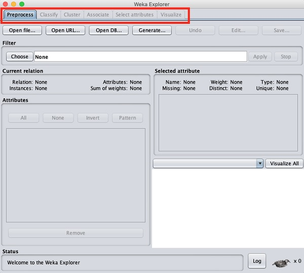

# Practical 1: Installation and Study Of WEKA

**Aim:** Installation and Study Of WEKA.

## Theory

WEKA - an open source software provides tools for data preprocessing, implementation of several Machine Learning algorithms, and visualization tools so that you can develop machine learning techniques and apply them to real-world data mining problems.

To install WEKA on your machine, visit WEKA’s official website and download the installation file. WEKA supports installation on Windows, Mac OS X and Linux.

First, you will start with the raw data collected from the field. This data may contain several null values and irrelevant fields. You use the data preprocessing tools provided in WEKA to cleanse the data.

Then, you would save the preprocessed data in your local storage for applying ML algorithms.

Next, depending on the kind of ML model that you are trying to develop you would select one of the options such as Classify, Cluster, or Associate. The Attributes Selection allows the automatic selection of features to create a reduced dataset.

Note that under each category, WEKA provides the implementation of several algorithms. You would select an algorithm of your choice, set the desired parameters and run it on the dataset.

Then, WEKA would give you the statistical output of the model processing. It provides you a visualization tool to inspect the data.

The various models can be applied on the same dataset. You can then compare the outputs of different models and select the best that meets your purpose.

Thus, the use of WEKA results in a quicker development of machine learning models on the whole.

The GUI Chooser application allows you to run five different types of applications as listed here −

- Explorer
- Experimenter
- KnowledgeFlow
- Workbench
- Simple CLI

When you click on the Explorer button in the Applications selector, it opens the following screen −

On the top, you will see several tabs as listed here −

- Preprocess
- Classify
- Cluster
- Associate
- Select Attributes
- Visualize

Under these tabs, there are several pre-implemented machine learning algorithms.

## Preprocess Tab

Initially as you open the explorer, only the Preprocess tab is enabled. The first step in machine learning is to preprocess the data. Thus, in the Preprocess option, you will select the data file, process it and make it fit for applying the various machine learning algorithms.

## Classify Tab

The Classify tab provides you several machine learning algorithms for the classification of your data. To list a few, you may apply algorithms such as Linear Regression, Logistic Regression, Support Vector Machines, Decision Trees, RandomTree, RandomForest, NaiveBayes, and so on. The list is very exhaustive and provides both supervised and unsupervised machine learning algorithms.

## Cluster Tab

Under the Cluster tab, there are several clustering algorithms provided - such as SimpleKMeans, FilteredClusterer, HierarchicalClusterer, and so on.

## Associate Tab

Under the Associate tab, you would find Apriori, FilteredAssociator and FPGrowth.

## Select Attributes Tab

Select Attributes allows you feature selections based on several algorithms such as ClassifierSubsetEval, PrincipalComponents, etc.

## Visualize Tab

Lastly, the Visualize option allows you to visualize your processed data for analysis.

## Conclusion

Thus, WEKA was successfully installed and its GUI Chooser applications (Explorer, Experimenter, KnowledgeFlow, Workbench and Simple CLI) were studied. The Explorer's tabs — Preprocess, Classify, Cluster, Associate, Select Attributes and Visualize — together provide a complete workflow for loading data, cleaning it, applying machine learning algorithms and comparing their results.

## Output

_To be filled in after performing the practical._
