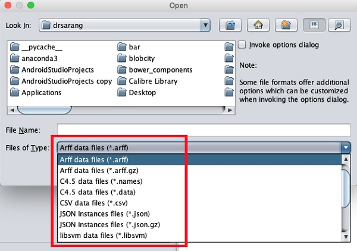
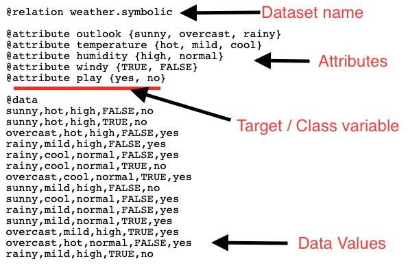
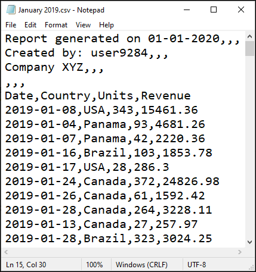

# Practical 2: Construct ARFF and CSV Files

**Aim:** Construct ARFF and CSV Files.

## Theory

WEKA supports a large number of file formats for the data. Here is the complete list −

- arff
- arff.gz
- bsi
- csv
- dat
- data
- json
- json.gz
- libsvm
- m
- names
- xrff
- xrff.gz

The types of files that it supports are listed in the drop-down list box at the bottom of the screen. This is shown in the screenshot given below.



As you would notice it supports several formats including CSV and JSON. The default file type is Arff.

## Arff Format

An Arff file contains two sections - header and data.

- The header describes the attribute types.
- The data section contains a comma separated list of data.

As an example for Arff format, the Weather data file loaded from the WEKA sample databases is shown below −



From the screenshot, you can infer the following points −

- The @relation tag defines the name of the database.
- The @attribute tag defines the attributes.
- The @data tag starts the list of data rows each containing the comma separated fields.
- The attributes can take nominal values as in the case of outlook shown here −

```
@attribute outlook (sunny, overcast, rainy)
```

- The attributes can take real values as in this case −

```
@attribute temperature real
```

- You can also set a Target or a Class variable called play as shown here −

```
@attribute play (yes, no)
```

- The Target assumes two nominal values yes or no.

## CSV Format

CSV (Comma Separated Values) is a simple file format used to store tabular data, such as a spreadsheet or database. A CSV file stores tabular data (numbers and text) in plain text. Each line of the file is a data record. Each record consists of one or more fields, separated by commas. The use of the comma as a field separator is the source of the name for this file format



## Output

_To be filled in after performing the practical._

## Conclusion

Thus, datasets were constructed in both ARFF and CSV formats and loaded into WEKA. An ARFF file has a header section (`@relation`, `@attribute`) that declares attribute names and types, followed by a `@data` section, while a CSV file stores only comma-separated records with the first row as the header. ARFF is WEKA's native format because it carries type information, whereas CSV is simpler and widely supported.
