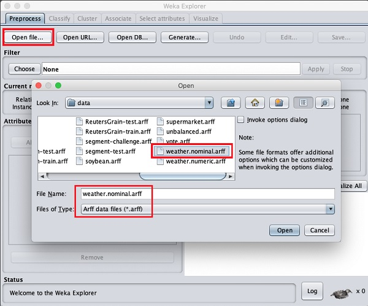
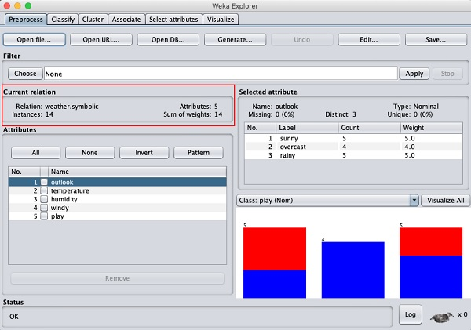
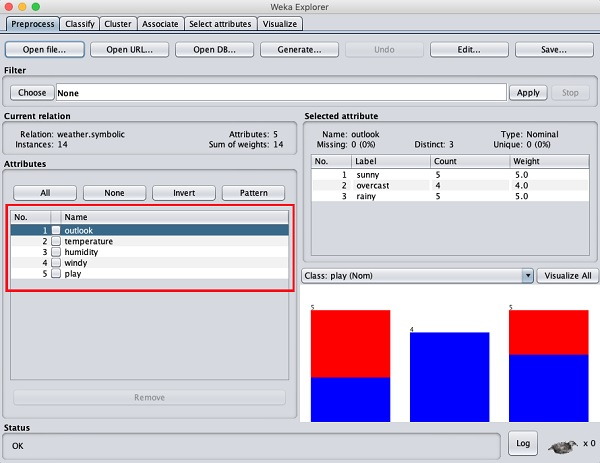
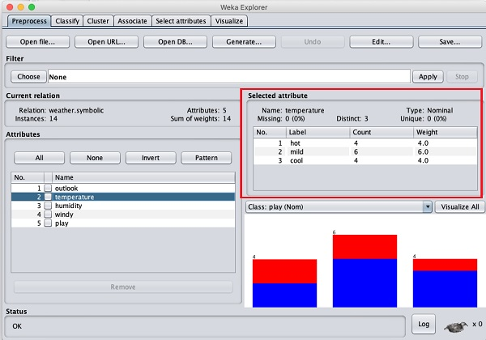
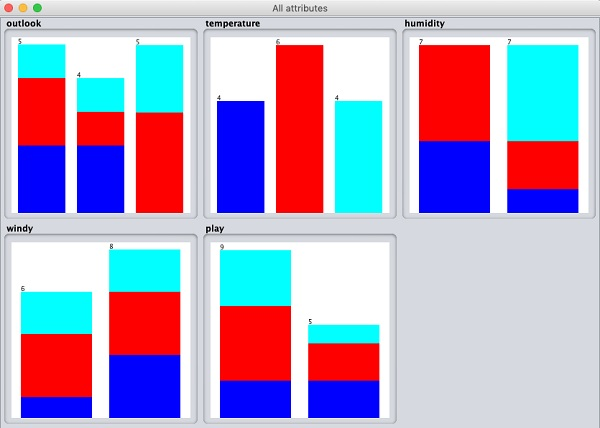
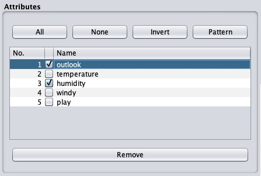
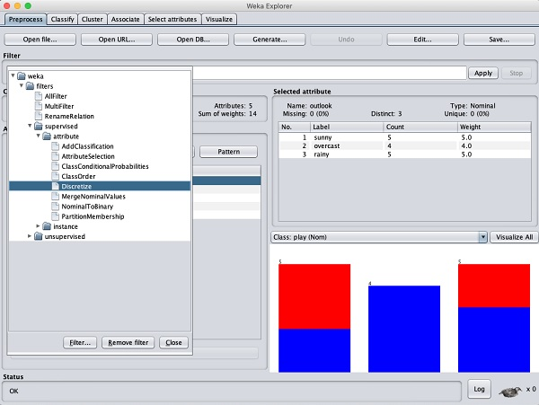
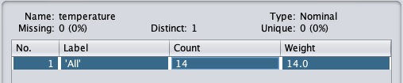
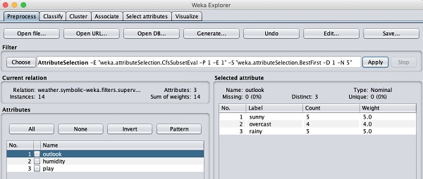

# Practical 3: Explore Different Pre-Processing Options in WEKA

**Aim:** Explore Different Pre-Processing Options in WEKA.

## Theory

The data that is collected from the field contains many unwanted things that leads to wrong analysis. For example, the data may contain null fields, it may contain columns that are irrelevant to the current analysis, and so on. Thus, the data must be preprocessed to meet the requirements of the type of analysis you are seeking. This is the done in the preprocessing module.

To demonstrate the available features in preprocessing, we will use the Weather database that is provided in the installation.

Using the Open file ... option under the Preprocess tag select the weather-nominal.arff file.

When you open the file, your screen looks like as shown here −

This screen tells us several things about the loaded data, which are discussed further in this chapter.

## Understanding Data

Let us first look at the highlighted Current relation sub window. It shows the name of the database that is currently loaded. You can infer two points from this sub window −

- There are 14 instances - the number of rows in the table.
- The table contains 5 attributes - the fields, which are discussed in the upcoming sections.

On the left side, notice the Attributes sub window that displays the various fields in the database.

The weather database contains five fields - outlook, temperature, humidity, windy and play. When you select an attribute from this list by clicking on it, further details on the attribute itself are displayed on the right hand side.

Let us select the temperature attribute first. When you click on it, you would see the following screen −

In the Selected Attribute subwindow, you can observe the following −

- The name and the type of the attribute are displayed.
- The type for the temperature attribute is Nominal.
- The number of Missing values is zero.
- There are three distinct values with no unique value.
- The table underneath this information shows the nominal values for this field as hot, mild and cold.
- It also shows the count and weight in terms of a percentage for each nominal value.

At the bottom of the window, you see the visual representation of the class values.

If you click on the Visualize All button, you will be able to see all features in one single window as shown here −

## 

## 

## Removing Attributes

Many a time, the data that you want to use for model building comes with many irrelevant fields. For example, the customer database may contain his mobile number which is relevant in analysing his credit rating.

To remove Attribute/s select them and click on the Remove button at the bottom.

The selected attributes would be removed from the database. After you fully preprocess the data, you can save it for model building.

## Applying Filters

Some of the machine learning techniques such as association rule mining requires categorical data. To illustrate the use of filters, we will use weather-numeric.arff database that contains two numeric attributes - temperature and humidity.

We will convert these to nominal by applying a filter on our raw data. Click on the Choose button in the Filter subwindow and select the following filter −

`weka→filters→supervised→attribute→Discretize`

Click on the Apply button and examine the temperature and/or humidity attribute. You will notice that these have changed from numeric to nominal types.

Let us look into another filter now. Suppose you want to select the best attributes for deciding the play. Select and apply the following filter −

`weka→filters→supervised→attribute→AttributeSelection`

You will notice that it removes the temperature and humidity attributes from the database.

After you are satisfied with the preprocessing of your data, save the data by clicking the Save ... button. You will use this saved file for model building.

## Output

_To be filled in after performing the practical._

## Conclusion

Thus, different pre-processing options in WEKA were explored on the weather dataset. We examined attribute statistics and visualizations, removed irrelevant attributes, converted numeric attributes to nominal using the Discretize filter, and selected the most relevant attributes using the AttributeSelection filter. Pre-processing improves data quality and makes it suitable for building accurate models.
