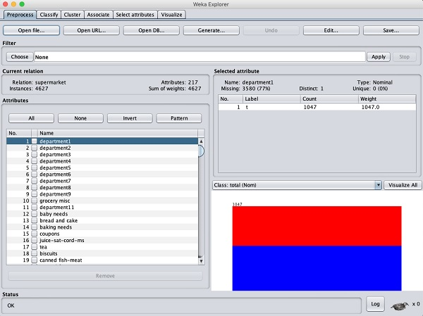
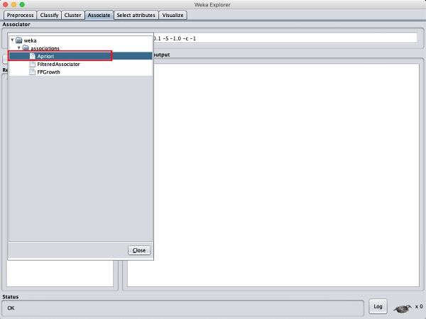
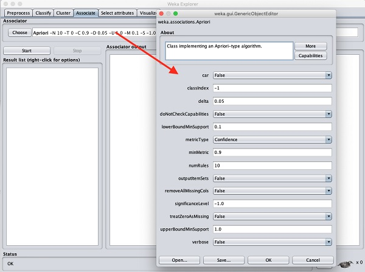
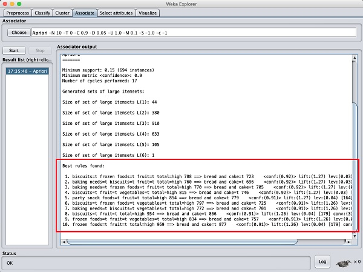

# Practical 4: To demonstrate the concept of association rule mining with the Apriori algorithm

**Aim:** To demonstrate the concept of association rule mining with the Apriori algorithm.

## Theory

Association rule mining is a popular technique used in data mining and machine learning to discover patterns and relationships between variables in a dataset. It involves finding frequent patterns or itemsets in a dataset and using these patterns to generate association rules that can help in making predictions or identifying interesting relationships between variables.

The Apriori algorithm is a widely used algorithm for association rule mining. It works by generating a set of candidate itemsets and pruning the sets that do not meet a minimum support threshold. The algorithm repeats this process until all frequent itemsets have been identified. Once frequent itemsets have been identified, association rules can be generated from them based on a minimum confidence threshold.

## Steps

To demonstrate the concept of association rule mining with the Apriori algorithm, follow these steps:

1. Open WEKA and load the dataset you want to mine.
2. Select the 'Associations' tab and then click on the 'Apriori' option.
3. Set the minimum support threshold and minimum confidence threshold for the algorithm.
4. Run the Apriori algorithm to identify frequent itemsets and generate association rules.
5. Analyze the results and use them to make predictions or identify interesting relationships between variables.

## Loading Data

In the WEKA explorer, open the Preprocess tab, click on the Open file ... button and select supermarket.arff database from the installation folder.

After the data is loaded you will see the following screen −

The database contains 4627 instances and 217 attributes. You can easily understand how difficult it would be to detect the association between such a large number of attributes. Fortunately, this task is automated with the help of Apriori algorithm.

## Associator

Click on the Associate TAB and click on the Choose button. Select the Apriori association as shown in the screenshot −

To set the parameters for the Apriori algorithm, click on its name, a window will pop up as shown below that allows you to set the parameters −

After you set the parameters, click the Start button. After a while you will see the results as shown in the screenshot below −

At the bottom, you will find the detected best rules of associations. This will help the supermarket in stocking their products in appropriate shelves.

## Output

_To be filled in after performing the practical._

## Conclusion

Thus, association rule mining was demonstrated using the Apriori algorithm on the supermarket dataset. By setting minimum support and confidence thresholds, Apriori found frequent itemsets and generated the best association rules, which reveal items that are often bought together and can guide decisions such as product placement.
