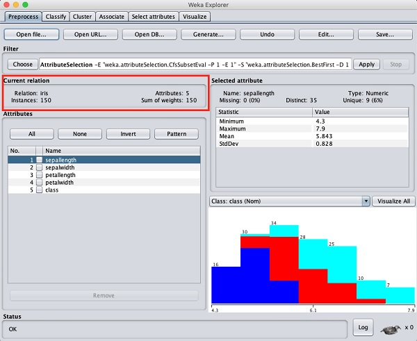
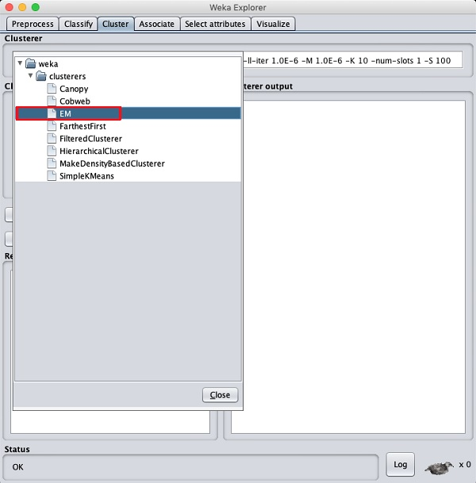
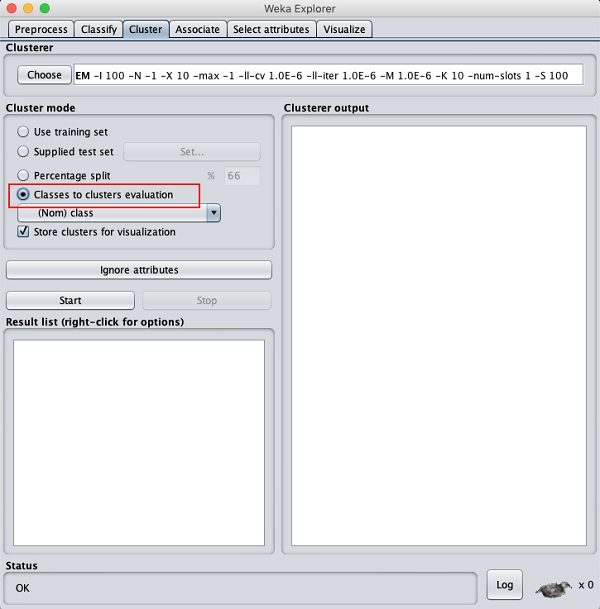
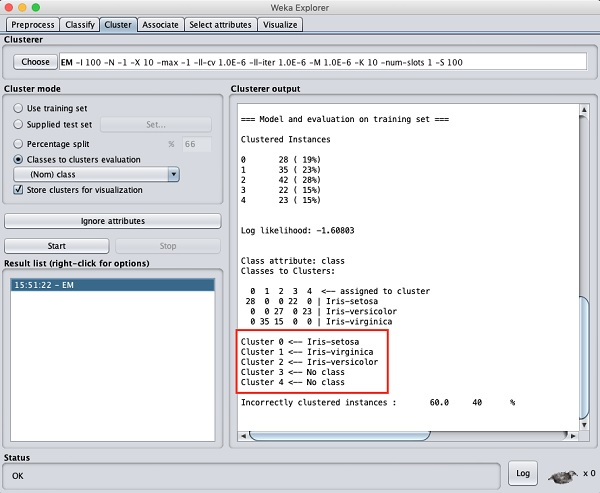
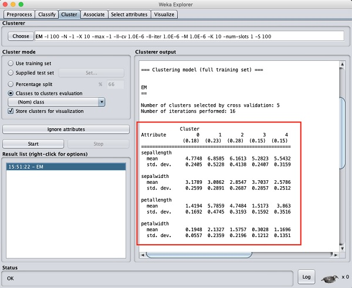
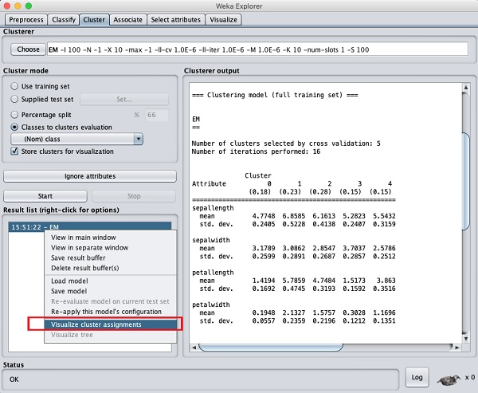
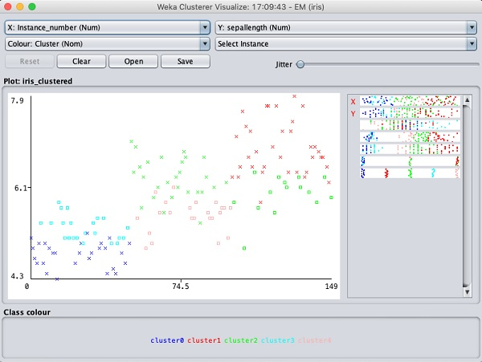
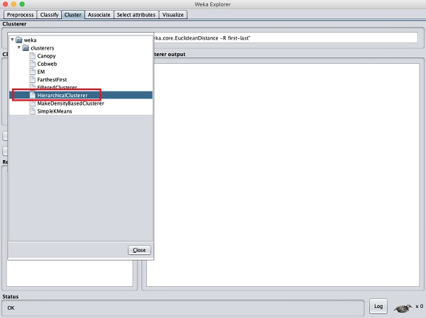
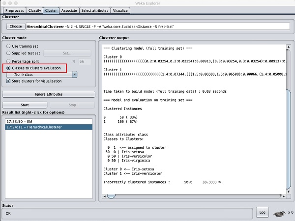
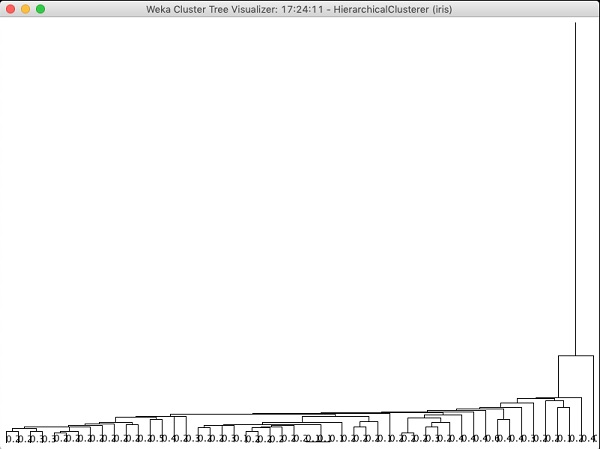

# Practical 5: To implement hierarchical clustering in WEKA

**Aim:** To implement hierarchical clustering in WEKA.

## Theory

Hierarchical clustering is a powerful technique for grouping similar objects together in a dataset. WEKA provides several algorithms for hierarchical clustering, including single-link, complete-link, and average-link clustering. By using these algorithms, users can create a hierarchical tree-like structure of clusters, with each cluster containing objects that are more similar to each other than to objects in other clusters. This can be a valuable tool for exploring relationships between objects in a dataset and identifying patterns and trends that may not be immediately apparent from the raw data.

Hierarchical clustering is a popular unsupervised learning technique used in data mining and machine learning to group similar objects together. It involves creating a hierarchical tree-like structure of clusters, with each cluster containing objects that are more similar to each other than to objects in other clusters. There are two types of hierarchical clustering: agglomerative and divisive.

Agglomerative clustering is a bottom-up approach that starts with each object as its own cluster and then merges the most similar pairs of clusters until all objects belong to a single cluster. Divisive clustering is a top-down approach that starts with all objects in a single cluster and then recursively divides the cluster into smaller clusters until each object is in its own cluster.

WEKA provides several algorithms for hierarchical clustering, including single-link, complete-link, and average-link clustering.

## Steps

To implement hierarchical clustering in WEKA, follow these steps:

1. Open WEKA and load the dataset you want to cluster.
2. Select the 'Cluster' tab and then click on the 'Hierarchical Clusterer' option.
3. Choose the type of hierarchical clustering you want to use, such as single-link, complete-link, or average-link clustering.
4. Set the number of clusters you want to create or leave it blank to create clusters automatically.
5. Run the hierarchical clustering algorithm and analyze the results.

## Loading Data

In the WEKA explorer select the Preprocess tab. Click on the Open file ... option and select the iris.arff file in the file selection dialog.

When you load the data, the screen looks like as shown below −

You can observe that there are 150 instances and 5 attributes. The attributes are listed as sepallength, sepalwidth, petallength, petalwidth and class. The first four attributes are of numeric type while the class is a nominal type with 3 distinct values. Examine each attribute to understand the features of the database. We will not do any preprocessing on this data and straight-away proceed to model building.

## Clustering

Click on the Cluster TAB to apply the clustering algorithms to our loaded data. Click on the Choose button. You will see the following screen −

Now, select EM as the clustering algorithm.

In the Cluster mode sub window, select the Classes to clusters evaluation option as shown in the screenshot below −

Click on the Start button to process the data. After a while, the results will be presented on the screen.

## Examining Output

The output of the data processing is shown in the screen below −

From the output screen, you can observe that −

- There are 5 clustered instances detected in the database.
- The Cluster 0 represents setosa, Cluster 1 represents virginica, Cluster 2 represents versicolor, while the last two clusters do not have any class associated with them.

If you scroll up the output window, you will also see some statistics that gives the mean and standard deviation for each of the attributes in the various detected clusters.

This is shown in the screenshot given below −

## Visualizing Clusters

To visualize the clusters, right click on the EM result in the Result list.

You will see the following options −

Select Visualize cluster assignments. You will see the following output −

As in the case of classification, you will notice the distinction between the correctly and incorrectly identified instances. You can play around by changing the X and Y axes to analyze the results. You may use jittering as in the case of classification to find out the concentration of correctly identified instances. The operations in visualization plot are similar to the one you studied in the case of classification.

## Applying Hierarchical Clusterer

To demonstrate the power of WEKA, let us now look into an application of another clustering algorithm. In the WEKA explorer, select the HierarchicalClusterer as your ML algorithm as shown in the screenshot shown below −

Choose the Cluster mode selection to Classes to cluster evaluation, and click on the Start button. You will see the following output −

Notice that in the Result list, there are two results listed: the first one is the EM result and the second one is the current Hierarchical. Likewise, you can apply multiple ML algorithms to the same dataset and quickly compare their results.

If you examine the tree produced by this algorithm, you will see the following output −

## Output

_To be filled in after performing the practical._

## Conclusion

Thus, clustering was implemented in WEKA on the iris dataset using both EM and the HierarchicalClusterer. Using the Classes to clusters evaluation, the clusters were compared with the actual classes, and the hierarchical clusterer produced a tree (dendrogram) showing how instances are merged step by step. Running several algorithms on the same data makes it easy to compare their results.
