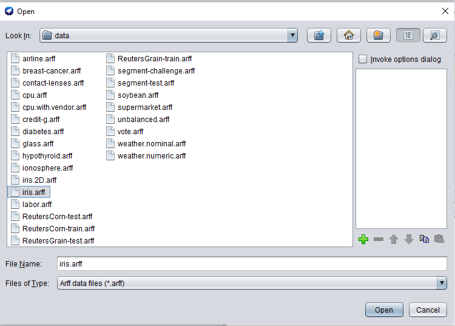
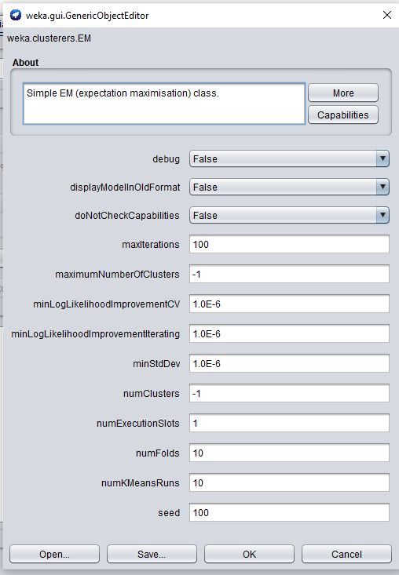
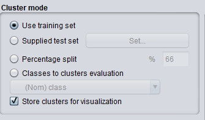
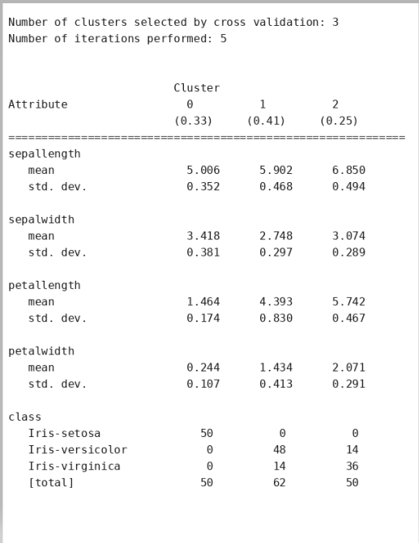
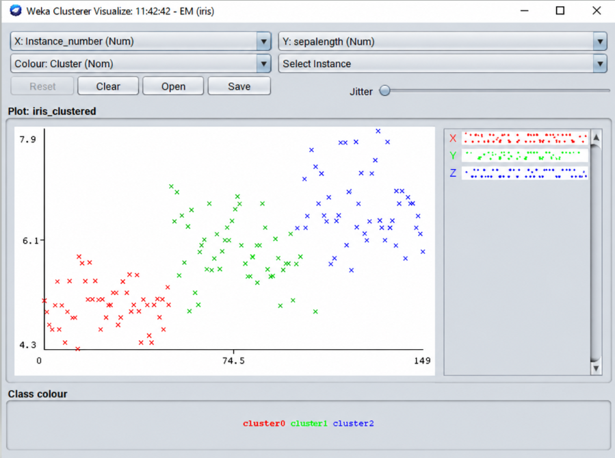

# Practical 6: To implement k-means clustering in WEKA

**Aim:** To implement k-means clustering in WEKA.

## Theory

K-means clustering is a popular unsupervised learning technique used in data mining and machine learning to group similar objects together. It involves partitioning a dataset into k clusters by minimizing the sum of squared distances between each object and the centroid of its assigned cluster.

K-means clustering is a powerful technique for grouping similar objects together in a dataset. WEKA provides a simple but effective implementation of k-means clustering through the 'SimpleKMeans' option in the 'Cluster' tab. By using this option, users can easily partition a dataset into k clusters and identify patterns and trends that may not be immediately apparent from the raw data.

The k-means algorithm works by selecting k random centroids and assigning each object to the nearest centroid. The algorithm then recalculates the centroids of each cluster and reassigns each object to the nearest centroid. This process is repeated until the centroids no longer move or a maximum number of iterations is reached.

## Procedure

To implement k-means clustering in WEKA, follow these steps:

1. Open WEKA and load the dataset you want to cluster.
2. Select the 'Cluster' tab and then click on the 'SimpleKMeans' option.
3. Set the number of clusters (k) you want to create.
4. Select the distance metric you want to use, such as Euclidean, Manhattan, or Chebyshev distance.
5. Set the maximum number of iterations or leave it blank to use the default value.
6. Run the k-means clustering algorithm and analyze the results.

### Steps to be followed:

**Step 1:** In the preprocessing interface, open the Weka Explorer and load the required dataset, and we are taking the iris.arff dataset.

**Step 2:** Find the ‘cluster’ tab in the explorer and press the choose button to execute clustering. A dropdown list of available clustering algorithms appears as a result of this step and selects the simple-k means algorithm.

**Step 3:** Then, to the right of the choose icon, press the text button to bring up the popup window shown in the screenshots. We enter three for the number of clusters in this window and leave the seed value alone. The seed value is used to generate a random number that is used to make internal assignments of instances of clusters.

**Step 4:** One of the choices has been chosen. We must ensure that they are in the ‘cluster mode’ panel before running the clustering algorithm. The choice to use a training set is selected, and then the ‘start’ button is pressed. The screenshots below display the process and the resulting window.

**Step 5:** The centroid of each cluster is shown in the result window, along with statistics on the number and percent of instances allocated to each cluster. Each cluster centroid is represented by a mean vector. This cluster can be used to describe a cluster.

**Step 6:** Another way to grasp the characteristics of each cluster is to visualize them. To do so, right-click the result set on the result. Selecting to visualize cluster assignments from the list column.

## Output

_To be filled in after performing the practical._

## Conclusion

Thus, k-means clustering was implemented in WEKA using SimpleKMeans on the iris dataset with k = 3. The algorithm assigned each instance to the nearest centroid and iteratively updated the centroids, and the output showed the centroid (mean vector) of each cluster and the number of instances in each. Visualizing cluster assignments helped interpret the clusters formed.
