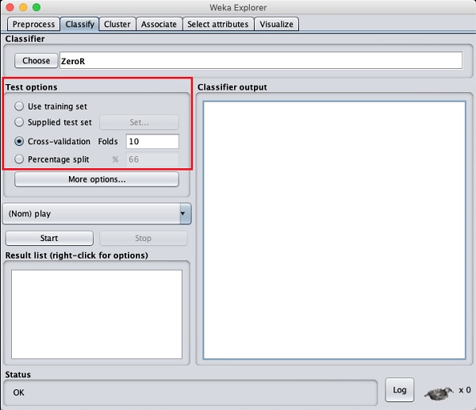
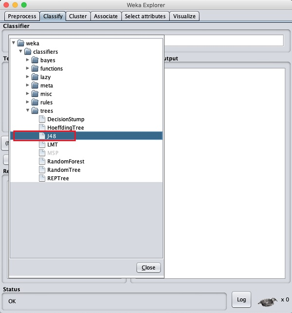
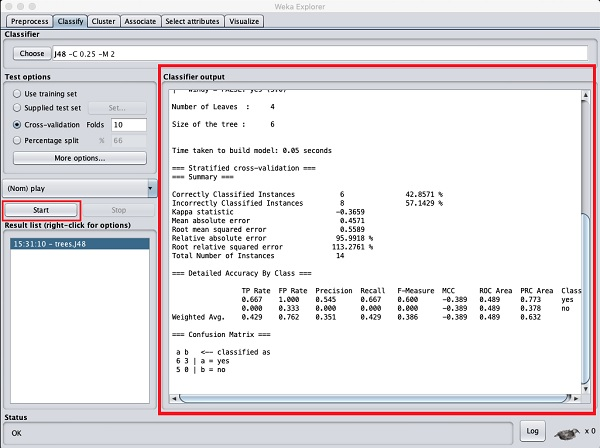
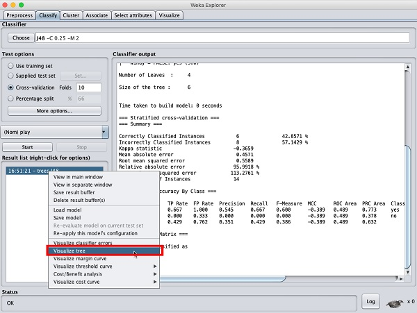
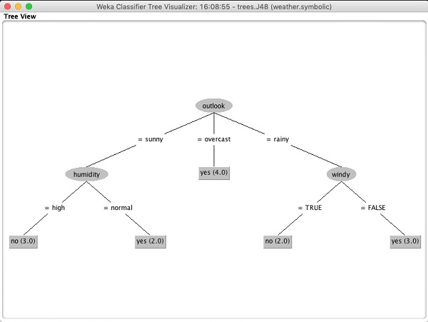
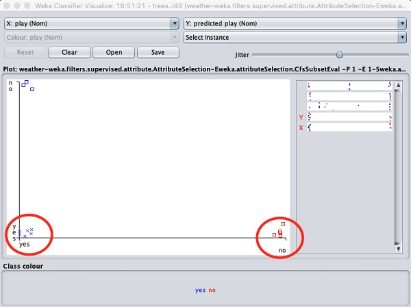
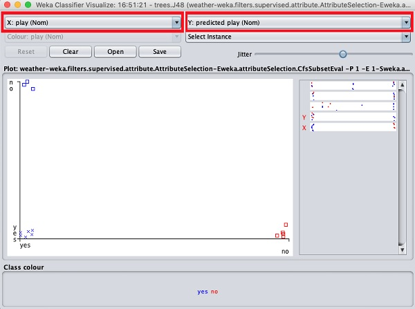
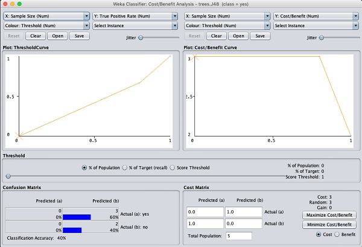

# Practical 7: To implement the J48 classification algorithm in WEKA

**Aim:** To implement the J48 classification algorithm in WEKA.

## Theory

The J48 algorithm is a popular decision tree algorithm used in data mining and machine learning to classify data. It works by recursively splitting the data into subsets based on the values of input features, until a stopping criterion is reached. Each split is chosen to maximize the information gain or minimize the entropy of the data at each node.

The J48 algorithm is a Java implementation of the C4.5 algorithm developed by Ross Quinlan. It has several advantages over other decision tree algorithms, including the ability to handle both categorical and continuous input features and to handle missing data.

## Procedure

To implement the J48 classification algorithm in WEKA, follow these steps:

1. Open WEKA and load the dataset you want to classify.
2. Select the 'Classify' tab and then click on the 'J48' option.
3. Set the options for the J48 algorithm, such as the confidence factor, minimum number of objects per leaf, and binary splits.
4. Run the J48 algorithm and analyze the results.
5. Setting Test Data

We will use the preprocessed weather data file from the previous lesson. Open the saved file by using the Open file ... option under the Preprocess tab, click on the Classify tab, and you would see the following screen −

## Selecting Classifier

Click on the Choose button and select the following classifier −

`weka→classifiers→trees→J48`

This is shown in the screenshot below −

Click on the Start button to start the classification process. After a while, the classification results would be presented on your screen as shown here −

Let us examine the output shown on the right hand side of the screen.

It says the size of the tree is 6. You will very shortly see the visual representation of the tree. In the Summary, it says that the correctly classified instances as 2 and the incorrectly classified instances as 3, It also says that the Relative absolute error is 110%. It also shows the Confusion Matrix. Going into the analysis of these results is beyond the scope of this tutorial. However, you can easily make out from these results that the classification is not acceptable and you will need more data for analysis, to refine your features selection, rebuild the model and so on until you are satisfied with the model’s accuracy. Anyway, that’s what WEKA is all about. It allows you to test your ideas quickly.

## Visualize Results

To see the visual representation of the results, right click on the result in the Result list box. Several options would pop up on the screen as shown here −

Select Visualize tree to get a visual representation of the traversal tree as seen in the screenshot below −

Selecting Visualize classifier errors would plot the results of classification as shown here −

A cross represents a correctly classified instance while squares represents incorrectly classified instances. At the lower left corner of the plot you see a cross that indicates if outlook is sunny then play the game. So this is a correctly classified instance. To locate instances, you can introduce some jitter in it by sliding the jitter slide bar.

The current plot is outlook versus play. These are indicated by the two drop down list boxes at the top of the screen.

Now, try a different selection in each of these boxes and notice how the X & Y axes change. The same can be achieved by using the horizontal strips on the right hand side of the plot. Each strip represents an attribute. Left click on the strip sets the selected attribute on the X-axis while a right click would set it on the Y-axis.

There are several other plots provided for your deeper analysis. Use them judiciously to fine tune your model. One such plot of Cost/Benefit analysis is shown below for your quick reference.

## Output

_To be filled in after performing the practical._

## Conclusion

Thus, the J48 (C4.5) decision tree classifier was implemented in WEKA on the weather dataset. The output showed the tree size, correctly and incorrectly classified instances, error measures and the confusion matrix, and the tree and classifier errors were visualized. Because the dataset is very small, the accuracy was low, showing that more data and better feature selection are needed for a reliable model.
