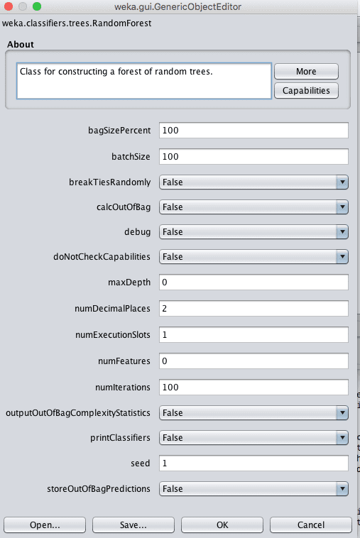
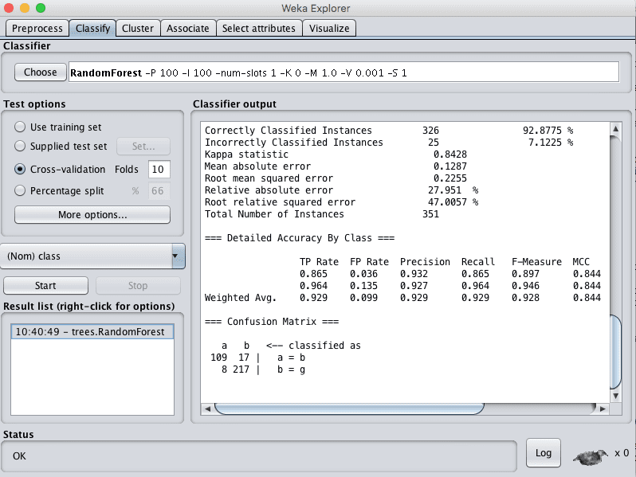

# Practical 8: To implement the Random Tree algorithm in WEKA

**Aim:** To implement the Random Tree algorithm in WEKA.

## Theory

Random Tree is a popular decision tree algorithm used in data mining and machine learning to classify data. The algorithm works by constructing a forest of decision trees at random and aggregating their predictions. Each tree is constructed using a random subset of the features and a random subset of the data.

The Random Tree algorithm is similar to the Random Forest algorithm, but it constructs only one tree instead of an ensemble of trees. It has several advantages over other decision tree algorithms, including the ability to handle large datasets and noisy data.

Random Tree algorithm is a powerful decision tree algorithm used in data mining and machine learning to classify data. WEKA provides a simple but effective implementation of the Random Tree algorithm through the 'RandomTree' option in the 'Classify' tab. By using this option, users can easily classify data based on input features and identify patterns and trends that may not be immediately apparent from the raw data.

## Procedure

To implement the Random Tree algorithm in WEKA, follow these steps:

1. Open WEKA and load the dataset you want to classify.
2. Select the 'Classify' tab and then click on the 'RandomTree' option.
3. Set the options for the Random Tree algorithm, such as the number of features to use, the number of trees to construct, and the seed for the random number generator.
4. Run the Random Tree algorithm and analyze the results.

Choose the random forest algorithm:

1. Click the “Choose” button and select “RandomForest” under the “trees” group.
2. Click on the name of the algorithm to review the algorithm configuration.

3. Weka Configuration for the Random Forest Algorithm

In addition to the parameters listed above for bagging, a key parameter for random forest is the number of attributes to consider in each split point. In Weka this can be controlled by the numFeatures attribute, which by default is set to 0, which selects the value automatically based on a rule of thumb.

1. Click “OK” to close the algorithm configuration.
2. Click the “Start” button to run the algorithm on the Ionosphere dataset.
3. You can see that with the default configuration that random forests achieves an accuracy of 92%.

## Output

_To be filled in after performing the practical._

## Conclusion

Thus, a tree-based classifier was implemented in WEKA from the Classify tab under the trees group. Building trees from random subsets of features handles large and noisy data well, and the random forest (an ensemble of random trees) achieved about 92% accuracy on the Ionosphere dataset with the default configuration, showing that randomized trees give strong classification performance.
