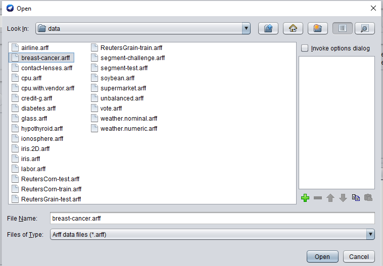
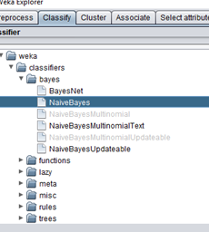
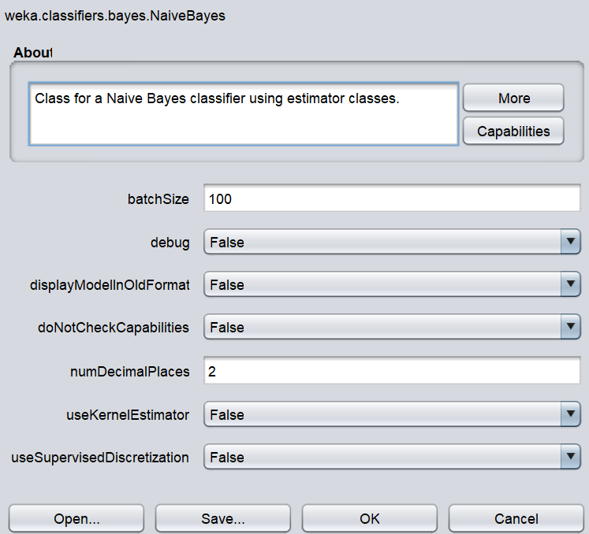
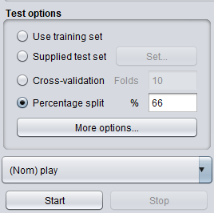
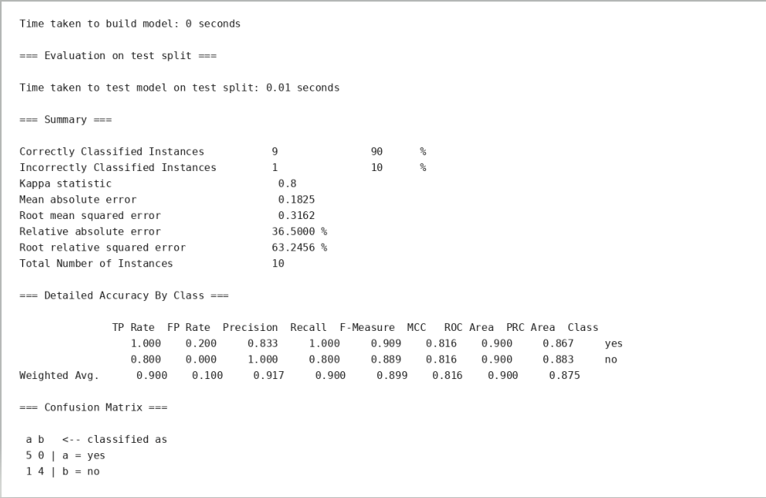

# Practical 9: To demonstrate statistical analysis with Naive Bayes algorithm

**Aim:** To demonstrate statistical analysis with Naive Bayes algorithm.

## Theory

Naive Bayes is a popular machine learning algorithm used for classification problems. It is based on Bayes' theorem, which describes the probability of an event based on prior knowledge of conditions that might be related to the event. The Naive Bayes algorithm assumes that the features of the data are conditionally independent given the class, which simplifies the calculation of the probabilities.

The Naive Bayes algorithm is a powerful statistical algorithm used in machine learning to classify data. WEKA provides a simple but effective implementation of the Naive Bayes algorithm through the 'NaiveBayes' option in the 'Classify' tab. By using this option, users can easily classify data based on input features and identify patterns and trends that may not be immediately apparent from the raw data.

Statistical analysis is an essential part of machine learning, as it helps to identify relationships and patterns in the data. Naive Bayes is a statistical algorithm that makes use of probability distributions to estimate the likelihood of a data point belonging to a particular class.

## Procedure

To demonstrate statistical analysis with the Naive Bayes algorithm in WEKA, follow these steps:

1. Open WEKA and load the dataset you want to classify.
2. Select the 'Classify' tab and then click on the 'NaiveBayes' option.
3. Set the options for the Naive Bayes algorithm, such as the type of probability distribution to use and the kernel estimator.
4. Run the Naive Bayes algorithm and analyze the results.

Steps to be followed:

1. Initially, we have to load the required dataset in the weka tool using choose file option. Here we are selecting the weather-nominal dataset to execute.

2. Now we have to go to the classify tab on the top left side and click on the choose button and select the Naive Bayesian algorithm in it.

3. Now to change the parameters click on the right side at the choose button, and we are accepting the default values in this example.

4. We choose the Percentage split as our measurement method from the “Test” choices in the main panel. Since we don’t have a separate test data collection, we’ll use the percentage split of 66 percent to get a good idea of the model’s accuracy. Our dataset contains 14 examples, with 9 being used for training and 5 being used for testing.

5. To generate the model, we now click “start.” When the model is done, the evaluation statistic will appear in the right panel.

## Output

_To be filled in after performing the practical._

## Conclusion

Thus, statistical analysis was demonstrated using the Naive Bayes classifier on the weather-nominal dataset with a 66% percentage split (9 instances for training and 5 for testing). Naive Bayes applies Bayes' theorem with the assumption that attributes are independent given the class, and it gave class probabilities along with evaluation statistics such as accuracy and the confusion matrix.
