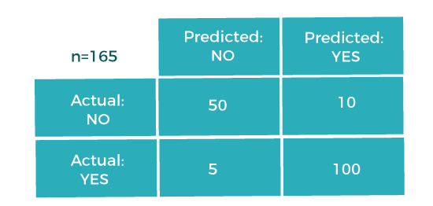
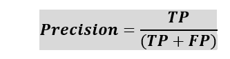
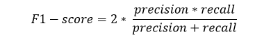
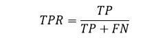
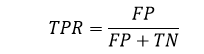
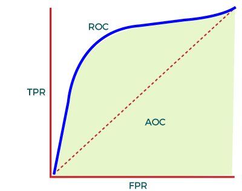
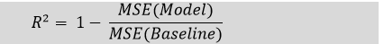
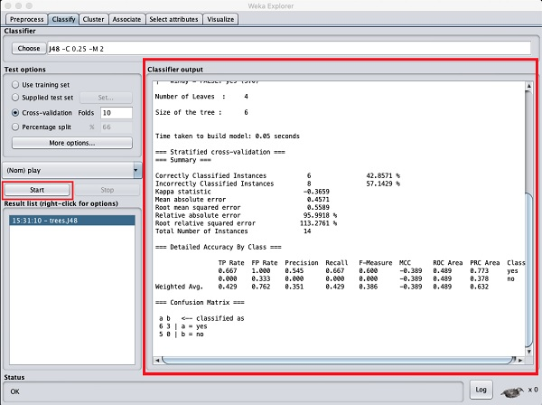

# Practical 10: To evaluate data mining techniques with different performance metrics

**Aim:** To evaluate data mining techniques with different performance metrics.

## Theory

Data mining techniques can be evaluated using various performance metrics such as accuracy, precision, recall, F1 score, ROC curve, and confusion matrix. These metrics can be used to identify the strengths and weaknesses of different algorithms and to compare the performance of different algorithms on a given dataset. WEKA provides a simple but effective way to evaluate data mining techniques using different performance metrics, making it easier for users to choose the best algorithm for their specific needs.

## Performance Metrics for Classification

In a classification problem, the category or classes of data is identified based on training data. The model learns from the given dataset and then classifies the new data into classes or groups based on the training. It predicts class labels as the output, such as Yes or No, 0 or 1, Spam or Not Spam, etc. To evaluate the performance of a classification model, different metrics are used, and some of them are as follows:

- Accuracy
- Confusion Matrix
- Precision
- Recall
- F-Score
- AUC(Area Under the Curve)-ROC

### I. Accuracy

The accuracy metric is one of the simplest Classification metrics to implement, and it can be determined as the number of correct predictions to the total number of predictions.

It can be formulated as:

`Accuracy = (TP + TN) / (TP + TN + FP + FN)`

### II. Confusion Matrix

A confusion matrix is a tabular representation of prediction outcomes of any binary classifier, which is used to describe the performance of the classification model on a set of test data when true values are known.

The confusion matrix is simple to implement, but the terminologies used in this matrix might be confusing for beginners.

A typical confusion matrix for a binary classifier looks like the below image(However, it can be extended to use for classifiers with more than two classes).

In the matrix, columns are for the prediction values, and rows specify the Actual values. Here Actual and prediction give two possible classes, Yes or No. So, if we are predicting the presence of a disease in a patient, the Prediction column with Yes means, Patient has the disease, and for NO, the Patient doesn't have the disease.

- In this example, the total number of predictions are 165, out of which 110 time predicted yes, whereas 55 times predicted No.
- However, in reality, 60 cases in which patients don't have the disease, whereas 105 cases in which patients have the disease.

In general, the table is divided into four terminologies, which are as follows:

- True Positive(TP): In this case, the prediction outcome is true, and it is true in reality, also.
- True Negative(TN): in this case, the prediction outcome is false, and it is false in reality, also.
- False Positive(FP): In this case, prediction outcomes are true, but they are false in actuality.
- False Negative(FN): In this case, predictions are false, and they are true in actuality.

### III. Precision

The precision metric is used to overcome the limitation of Accuracy. The precision determines the proportion of positive prediction that was actually correct. It can be calculated as the True Positive or predictions that are actually true to the total positive predictions (True Positive and False Positive).

`Precision = TP / (TP + FP)`

### IV. Recall or Sensitivity

It is also similar to the Precision metric; however, it aims to calculate the proportion of actual positive that was identified incorrectly. It can be calculated as True Positive or predictions that are actually true to the total number of positives, either correctly predicted as positive or incorrectly predicted as negative (true Positive and false negative).

The formula for calculating Recall is given below:

`Recall = TP / (TP + FN)`

### V. F-Scores

F-score or F1 Score is a metric to evaluate a binary classification model on the basis of predictions that are made for the positive class. It is calculated with the help of Precision and Recall. It is a type of single score that represents both Precision and Recall. So, the F1 Score can be calculated as the harmonic mean of both precision and Recall, assigning equal weight to each of them.

The formula for calculating the F1 score is given below:

`F1 = 2 × (Precision × Recall) / (Precision + Recall)`

### VI. AUC-ROC

Sometimes we need to visualize the performance of the classification model on charts; then, we can use the AUC-ROC curve. It is one of the popular and important metrics for evaluating the performance of the classification model.

ROC represents a graph to show the performance of a classification model at different threshold levels.

The curve is plotted between two parameters, which are:

- True Positive Rate
- False Positive Rate

TPR or true Positive rate is a synonym for Recall, hence can be calculated as:

`TPR = TP / (TP + FN)`

FPR or False Positive Rate can be calculated as:

`FPR = FP / (FP + TN)`

To calculate value at any point in a ROC curve, we can evaluate a logistic regression model multiple times with different classification thresholds, but this would not be much efficient. So, for this, one efficient method is used, which is known as AUC.

### AUC: Area Under the ROC curve

AUC is known for Area Under the ROC curve. As its name suggests, AUC calculates the two-dimensional area under the entire ROC curve, as shown below image:

AUC calculates the performance across all the thresholds and provides an aggregate measure. The value of AUC ranges from 0 to 1. It means a model with 100% wrong prediction will have an AUC of 0.0, whereas models with 100% correct predictions will have an AUC of 1.0.

## Performance Metrics for Regression

Regression is a supervised learning technique that aims to find the relationships between the dependent and independent variables. A predictive regression model predicts a numeric or discrete value. The metrics used for regression are different from the classification metrics. It means we cannot use the Accuracy metric (explained above) to evaluate a regression model; instead, the performance of a Regression model is reported as errors in the prediction. Following are the popular metrics that are used to evaluate the performance of Regression models.

- Mean Absolute Error
- Mean Squared Error
- R2 Score
- Adjusted R2

### I. Mean Absolute Error (MAE)

Mean Absolute Error or MAE is one of the simplest metrics, which measures the absolute difference between actual and predicted values, where absolute means taking a number as Positive.

The below formula is used to calculate MAE:

`MAE = (1/N) × Σ |Y − Y'|`

Here, Y is the Actual outcome, Y' is the predicted outcome, and N is the total number of data points.

### II. Mean Squared Error

Mean Squared error or MSE is one of the most suitable metrics for Regression evaluation. It measures the average of the Squared difference between predicted values and the actual value given by the model.

Since in MSE, errors are squared, therefore it only assumes non-negative values, and it is usually positive and non-zero.

Moreover, due to squared differences, it penalizes small errors also, and hence it leads to over-estimation of how bad the model is.

MSE is a much-preferred metric compared to other regression metrics as it is differentiable and hence optimized better.

The formula for calculating MSE is given below:

`MSE = (1/N) × Σ (Y − Y')²`

Here, Y is the Actual outcome, Y' is the predicted outcome, and N is the total number of data points.

### III. R Squared Score

R squared error is also known as Coefficient of Determination, which is another popular metric used for Regression model evaluation. The R-squared metric enables us to compare our model with a constant baseline to determine the performance of the model. To select the constant baseline, we need to take the mean of the data and draw the line at the mean.

The R squared score will always be less than or equal to 1 without concerning if the values are too large or small.

`R² = 1 − (SS_res / SS_tot)`

### IV. Adjusted R Squared

Adjusted R squared, as the name suggests, is the improved version of R squared error. R square has a limitation of improvement of a score on increasing the terms, even though the model is not improving, and it may mislead the data scientists.

To overcome the issue of R square, adjusted R squared is used, which will always show a lower value than R². It is because it adjusts the values of increasing predictors and only shows improvement if there is a real improvement.

We can calculate the adjusted R squared as follows:

![Adjusted R² = 1 − [ (n − 1) / (n − k − 1) × (1 − R²) ]](images/image59.png)

`Adjusted R² = 1 − [ (n − 1) / (n − k − 1) × (1 − R²) ]`

Here, n is the number of observations,k denotes the number of independent variables and Ra2 denotes the adjusted R2

## Procedure

To evaluate data mining techniques with different performance metrics in WEKA, follow these steps:

1. Open WEKA and load the dataset you want to evaluate.
2. Select the 'Classify' tab and then select the algorithm you want to evaluate, such as Naive Bayes or J48.
3. Set the options for the algorithm, such as the type of probability distribution to use and the number of folds for cross-validation.
4. Run the algorithm and analyze the performance metrics, such as accuracy, precision, recall, F1 score, ROC curve, and confusion matrix.

## Output

_To be filled in after performing the practical._

## Conclusion

Thus, data mining techniques were evaluated in WEKA using different performance metrics. For classification we used accuracy, the confusion matrix, precision, recall, F1-score and AUC-ROC, and for regression we studied MAE, MSE, R² and adjusted R². Since no single metric tells the whole story, comparing several of them helps choose the most suitable algorithm for a dataset.
